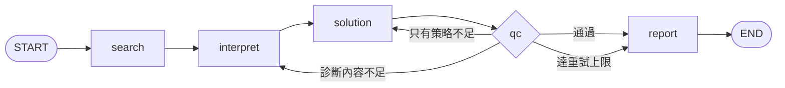

# Agentic AI｜ESG 報告評估多代理協作系統

以 **LangGraph** 串接多個代理，分析企業永續報告書 PDF，產出 E／S／G 三個面向的亮點、待改善事項、KPI 與改善策略，並為每項結論附上**可追溯的原文引用與頁碼**。全程使用本機 LLM（Ollama），並以 Langfuse 做 tracing。

這個專案的重點不只是「讓流程跑起來」，而是**如何知道輸出是對的**：本 README 的後半部完整記錄了開發過程中，用 trace、原始 PDF 與測試核對出來的問題與修正。

> 範例輸出：[`examples/`](examples/)（以中信證券 2024 永續報告書為例）

---

## 功能

- **E／S／G 分析**：亮點、待改善事項、KPI、短／中／長期策略（每面向 5 項）
- **可追溯的引用**：每項結論附公司、年度、頁碼與原文摘錄
- **KPI 品質把關**：數值必須出現在被引用的原文、名稱必須在數值附近、只收「已發生的實績」（排除目標與政策門檻）、模型自己算的數字標示為「推算」
- **同產業最佳實踐**（知識庫檢索）與 **GRI 缺口分析**
- **QC 與條件式重試**：依失敗原因回到 interpret 或只回到 solution
- **可觀測性**：Langfuse trace（節點、LLM 呼叫、QC 結果、KPI 處理結果）

## 流程



| 節點 | 負責 |
|---|---|
| `search` | PyMuPDF 解析 PDF、清理、切分，建立 ChromaDB 向量索引（含知識庫文件），每個 chunk 帶真實頁碼 |
| `interpret` | 依 E／S／G 檢索相關片段，LLM 產出亮點、待改善事項、KPI；KPI 經確定性檢查才保留 |
| `solution` | 每個面向各自生成 5 項策略；檢索最佳實踐；GRI 缺口分析 |
| `qc` | 檢查三個面向是否有實際內容（佔位字串不算）、各面向策略數量是否足夠；上游整個失敗時略過策略生成並回到 interpret（最多重試 2 次） |
| `report` | 輸出 Markdown 與 JSON；未通過 QC 的報告會在開頭明確標示 |

## 範例（節錄）

以下數值都已對照 PDF 原文核對（實際內容以 `examples/` 為準）：

| KPI | 數值 | 原文頁碼 |
|---|---|---|
| 投資組合財務碳排放量（2024） | 43,319 tCO2e | p58 |
| 財務碳排放強度 | 5.51 tCO2e／新臺幣百萬元 | p58 |
| 投資組合盤查覆蓋率 | 38 % | p58 |
| 全員資安教育訓練人數 | 723 人 | p93 |
| 證券商（高級）業務員證照取得 | 526 人次 | p63 |
| 董事會召開次數 | 15 次／年 | p76 |

## 快速開始

### 1. 安裝

```powershell
python -m venv venv
venv\Scripts\activate
pip install -r requirements.txt
```

另外需要本機的 [Ollama](https://ollama.com)，並準備好模型（本專案開發時使用 `gemma4-plan:latest`，是自訂模型名稱，請換成你自己的模型）。

### 2. 設定

複製 `.env.example` 為 `.env` 並填入內容。**`.env` 不要提交到 Git。**

- 必要：`ESG_MODEL`（預設 `ollama/gemma4-plan:latest`）
- 建議：`ESG_THINK=0`（關閉思考模式；見下方「問題 2」）
- 選用：`LANGFUSE_*`（tracing）、`ESG_TEMPERATURE`、`ESG_DEBUG_KPI`、`ESG_JUDGE_*`（KPI 檢查員實驗）

### 3. 準備資料

- 報告 PDF 放進 `data/reports/`（**本 repo 不附報告 PDF**，請自行從公司官方網站下載公開的永續報告書）
- 知識庫文件（`.md`）放進 `data/knowledge_base/`

### 4. 執行

```powershell
python coordinator_agent.py --file "<報告檔名>.pdf" --company "<公司名稱>" [--rebuild]
python verify_report.py --pdf "data\reports\<報告檔名>.pdf"
```

- 第一次執行或更換報告時加 `--rebuild`（重建向量索引）
- 輸出在 `outputs/`（`.md` 與 `.json`）
- `verify_report.py` 不給 JSON 檔名時，會檢查 `outputs/` 裡最新的一份

### 5. 測試

```powershell
pytest
```

118 項離線測試，不需要 PDF、Ollama、ChromaDB 或網路。測試只需要 `pytest`、`python-dotenv`、`langgraph`（CI 也是這樣跑）。

## 專案結構

```
coordinator_agent.py       # LangGraph 流程、QC、重試路由、報告輸出
search_agent.py            # PDF 擷取（PyMuPDF）、切分、頁碼、向量索引
interpretation_agent.py    # E/S/G 分析、KPI 抽取與過濾
solution_agent.py          # 策略、最佳實踐、GRI 缺口
citation.py                # 引用歸因、數值比對、鄰近與目標/實績判斷
esg_utils.py               # 路徑、LLM 呼叫封裝（LiteLLM）、embedding、ChromaDB
tracing.py                 # Langfuse 的薄包裝（未設定金鑰時為無作用版本）
kpi_judge.py               # （實驗，預設關閉）LLM 檢查員，要求逐字引用原文
verify_report.py           # 報告自動檢查（14 項）
evaluate_judge.py          # 量測檢查員模型的準確度
inspect_pdf_page.py        # 診斷：PDF 某頁的原始文字與清理結果
test_ollama_direct.py      # 診斷：直接呼叫 Ollama，比較思考開／關
test_litellm_think.py      # 診斷：LiteLLM 各種關閉思考寫法的 token 用量
tests/                     # 離線測試（unit／integration）
data/knowledge_base/       # 最佳實踐與 GRI 知識庫
specs/                     # 規格驅動開發（GitHub spec-kit）的設計文件
examples/                  # 範例輸出
eval/                      # 早期的評測腳本（含已知限制，見下方）
```

## 品質把關：三層

1. **流程內的確定性檢查**（KPI）：數值出現在被引用片段、名稱關鍵字在數值附近、排除目標與政策門檻、排除殘缺名稱與模型的揣測。
2. **離線測試**：118 項。其中 78 項是針對下表的問題新增的回歸測試，多半用報告中實際出現過的錯誤當測資。對新增的每一項邏輯，我都用「故意破壞程式、確認測試會失敗」驗證過，過程中發現並加強了數項寫得太鬆的測試。
3. **`verify_report.py`**：直接讀輸出 JSON，14 項自動檢查（內容完整、策略數量、KPI 數量、殘渣與亂碼、頁碼具體、KPI 數值與名稱鄰近、最佳實踐來源等）。報告若是失敗流程的產物，會直接印出報告內記錄的錯誤。

## 開發過程中發現與修正的問題

| # | 現象 | 根因 | 修正與驗證 |
|---|---|---|---|
| 1 | 某次執行 G 面向沒有任何策略，QC 卻通過 | QC 只檢查策略總數；同時模型輸出剛好撞到 token 上限 | QC 改為逐面向檢查；策略改為各面向分別生成 |
| 2 | 小模型偶爾回傳空字串，整體耗時 6 至 11 分鐘 | 思考模型的思考過程佔掉大部分 token。直接測試同一個 prompt：開啟思考約 3270 token／100 秒，關閉約 226 token／5 秒 | 對 Ollama 模型關閉思考，整個流程約 1.5 至 2.5 分鐘（實測 89 至 158 秒，視是否觸發補問而定） |
| 3 | 報告把「投資金額絕對值揭露不足」列為缺點，原文其實有數字 | pdfplumber 在多欄排版會把數字拆到相鄰行（「新臺幣0.6億」變「新臺幣 億」） | 改用 PyMuPDF；「數字被拆離」樣式在整份報告中從 11 處降為 0，擷取時間由約 16 秒降到約 0.5 秒 |
| 4 | 所有 chunk 的頁碼都是 `p1-106` | 切分時把整份文件的頁碼範圍套給每個 chunk | 每個 chunk 記錄真實頁碼；317 個可核對的 chunk 全部落在正確頁面 |
| 5 | 最佳實踐一直是預設範本，卻標示來源為「知識庫」 | 傳入檔案清單時，`include_kb` 被忽略，知識庫從未被索引 | 修正索引；使用範本時明確標示來源 |
| 6 | 第二次執行起，分析品質明顯下降 | 索引未變動時走向量庫檢索，但查詢語句只有「面向＋公司名」，與首次執行不一致 | 兩條路徑統一使用含主題詞的查詢，並依面向過濾 |
| 7 | KPI 引用到主題相近、但沒有該數字的頁面（例如 526 人次在 p63，卻引到 p102） | 引用歸因只用語意相似度 | KPI 先找「文字真的含有該數值」的片段。以檢查腳本量測，引用的 chunk 含有該數值的比例：舊版報告 10／21，新版報告 17／17（另有 2 項標示為「推算」）。個位數的值（例：資料品質分數＝1）另外要求名稱就在數字旁邊 |
| 8 | 垃圾 KPI（斷句殘渣、名稱內的數字、被換行切斷的名稱、政策門檻、模型的揣測、籠統名稱） | 規則式抽取與 LLM 輸出的驗證太寬鬆 | 加入名稱與數值驗證，並以報告中實際出現的垃圾當測資 |
| 9 | KPI「董事長室配置資源＝100%」：數字存在於引用片段，意思卻是錯的（100% 其實是旁邊「完訓率」的數字） | 只比對數字字串抓不到錯配；我用 PDF 逐項人工核對才發現，連當時的自動檢查腳本也放行 | 新增「名稱關鍵字必須出現在數值附近」的檢查（句子裡的數值看前後 100 字；表格儲存格因欄位名稱可能在相鄰 chunk，不下結論），流程與檢查腳本共用同一份邏輯 |
| 10 | 2035 年的減碳目標（63%）、「設定完訓率為100%」被當成實績放進 KPI | 同一個數字在報告裡可能是承諾，也可能是結果 | 數值前 30 字內有「設定、訂定、目標、長期…」且沒有「完成、達成、合計、共…」才視為目標。第一版曾把「2024 年立案之客訴案件共56 件」誤判為目標（前面有「制定」），修正後加入該句為回歸測試 |
| 11 | 原文寫「共十日」，KPI 寫「10 天」，檢查卻是被別處不相干的 10（SDG 10、10 分鐘）湊巧放行 | 中文數字與阿拉伯數字字面不同 | 帶單位的中文數字（十日、七席、二十五人）轉成阿拉伯數字再比對，不轉換「統一」「十分」等一般詞彙 |
| 12 | 模型輸出不穩：KPI 區塊有時整個消失、標題寫法不一、偶爾出現亂碼字元（原文沒有） | 小模型的取樣雜訊；prompt 只給前 3000 字，可能沒包含數據表格 | KPI 不足時，用數值密度高的片段單獨再問一次；接受多種區塊標題；回應含亂碼時重問一次；每個面向的 KPI 處理結果寫進終端機與 trace |

**第 7 點的說明：** 17／17 有一部分是設計出來的結果（找得到就一定引用含該數值的片段），它只能保證「引用的段落含有這個數字」，不保證語意一定對應正確，語意層面由第 9、10 點的檢查補強。兩份報告的 KPI 清單也不同，是兩次不同的執行，不是同一批項目的前後對照。

## 可觀測性（Langfuse）

每次執行是一條 `esg_pipeline` trace，底下依序是各節點，LLM 呼叫巢狀在對應節點內；QC 節點的 metadata 記錄是否通過、問題清單與重試次數；Interpretation 節點記錄每個面向的 KPI 模型輸出行數、保留數與被捨棄的項目及原因。沒有設定金鑰時，所有追蹤函式為無作用版本，不影響執行與離線測試。

> 在此放一張 trace 展開圖截圖。

## KPI「LLM 檢查員」實驗（選用，預設關閉）

為了處理確定性檢查「無法判斷」的情況（例如數值在表格儲存格，欄位名稱在相鄰的 chunk），我試作了一個由另一個本機模型擔任的檢查員：它必須逐字引用原文，程式再驗證引文真的在證據裡、而且含有該數值，不符就一律視為不支持。

在 39 筆測資（19 個正例、1 個已知錯誤、19 個合成反例）上：

| | LLM 檢查員 | 確定性檢查 |
|---|---|---|
| 正例被接受 | 18／19 | 18／19（另 1 筆無法判斷） |
| 已知錯誤被拒絕 | 1／1 | 1／1 |
| 合成反例被拒絕 | 19／19 | 19／19 |

兩者在大多數案例答案一致，檢查員只在確定性檢查「無法判斷」的那 1 筆展現補位價值，每筆約 5 秒，且需要在兩個模型之間切換顯存。因此**預設關閉**，啟用時也只處理「無法判斷」的 KPI。測資中只有 1 個真實錯誤案例，合成反例也偏簡單，不能據此推論它對更難的錯配的表現。

## 已知限制與下一步

- **引用的語意評測尚未重做。** `eval/` 內早期的 faithfulness 評測有已知缺陷：只看引用的前 100 字、與檢索使用同一個 embedding（有循環）、LLM 評審只收到截斷成 60 字的內容，而且完全沒評 KPI 與策略。因此本 README 不引用舊分數。目前的品質把關以上述客觀檢查為主，亮點、待改善事項與策略的語意層面仍待補評測。
- **「目標 vs 實績」是用關鍵字判斷**，可能誤判，只用兩份真實報告驗證過；寧可漏判也不誤判，被濾掉的實績要靠同一份報告中的其他 KPI 涵蓋。
- **尚未實作 human-in-the-loop。** 計畫在 QC 失敗或信心不足時，用 LangGraph 的 interrupt 搭配 checkpointer 暫停等待人工確認。
- **重試仍可能耗盡。** 本機 LLM 服務若持續失敗，流程會輸出標示「未通過 QC」的報告。
- **chunk 偏碎。** 380 個 chunk 中位數長度約 120 字，其中約 100 個少於 30 字，影響檢索品質，考慮合併過短的 chunk。
- **小模型的文字雜訊。** 本機 4B 等級模型偶有錯字與格式雜訊，已清理並重問常見情況，但無法完全避免；KPI 名稱有時仍會過於籠統。
- **純表格頁。** PyMuPDF 對欄位式表格逐欄輸出，數字與所屬句子在一起，但不會還原成「整列資料」。
- **部分缺點是片段不足造成的。** LLM 只收到約 3000 字元的相關片段，有些「未見某項揭露」的判斷可能只是片段沒涵蓋。
- **顯存。** 主流程模型與檢查員模型不能同時載入，否則 Ollama 會因 CUDA 初始化失敗而崩潰。

## 授權與資料

- 本 repo 不附帶報告 PDF；報告內容的著作權屬於原發布公司。範例輸出只含短摘錄與頁碼。
- 依賴 PyMuPDF（AGPL）。個人與學習用途沒有問題；散布或商用前請自行確認授權相容性。
- 授權條款：（請自行補上）
